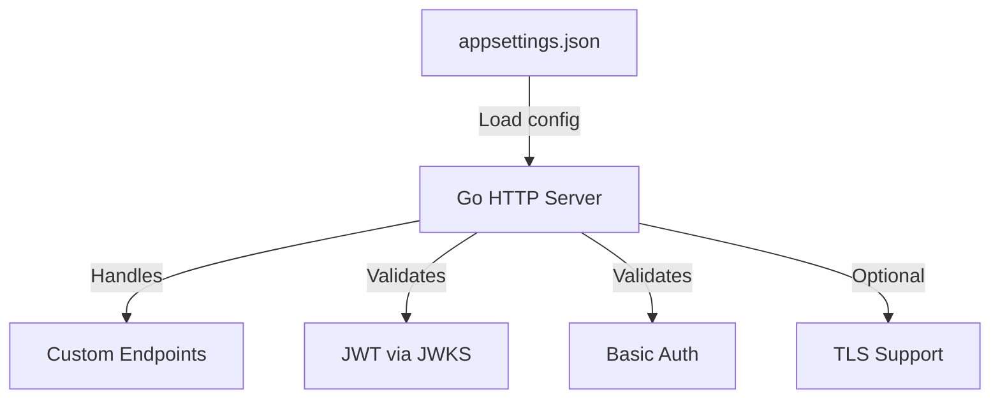

# serbathome-oauth-mock-server

A mock OAuth server for simulating authentication and authorization flows.

## Overview

This project provides a lightweight mock server to simulate OAuth authentication and authorization, useful for development and testing environments. It allows developers to test integrations with OAuth-protected APIs without requiring a real identity provider.

The server validates JWT and Basic Auth credentials against configurable parameters and serves responses on user-defined endpoints.

## Features

- Configurable endpoints for authentication simulation
- Supports JWT and Basic Authentication
- JWKS (JSON Web Key Set) validation for JWTs
- TLS support (optional)
- Customizable via `appsettings.json`
- Docker support for containerized deployment

## Architecture

The server loads configuration from `appsettings.json`, sets up HTTP handlers for each endpoint, and validates incoming requests using JWT or Basic Auth. JWT validation uses a remote JWKS endpoint. TLS can be enabled for secure communication.



## Technology Stack

- Go (Golang)
- net/http standard library
- github.com/golang-jwt/jwt/v4
- github.com/MicahParks/keyfunc
- Docker (optional)

## Prerequisites

- Go 1.22 or later
- (Optional) Docker
- Access to a JWKS endpoint (for JWT validation)

## Installation

```bash
git clone <repository-url>
cd serbathome-oauth-mock-server
go build -o mock-server server.go
```

Or build with Docker:

```bash
docker build -t mock-server .
```

## Configuration

Edit `appsettings.json` to set:

- `issuer`: Expected JWT issuer
- `audience`: Expected JWT audience
- `jwksUrl`: JWKS endpoint URL
- `authHeaderName`: Header for JWT
- `basicAuthUsername`/`basicAuthPassword`: Basic Auth credentials
- `port`: Server port (e.g., `:8080`)
- `endpoints`: List of endpoint paths
- `enableTLS`: Enable TLS (true/false)

Example:

```json
{
  "issuer": "https://sts.windows.net/your-tenant-id/",
  "audience": "api://your-api-id",
  "jwksUrl": "https://login.microsoftonline.com/common/discovery/keys",
  "authHeaderName": "x-ews-jwt-auth",
  "basicAuthUsername": "username",
  "basicAuthPassword": "password",
  "port": ":8080",
  "endpoints": ["/delta_extension1", "/delta_extension2"],
  "enableTLS": false
}
```

If `enableTLS` is true, generate certificates:

```bash
openssl req -x509 -newkey rsa:2048 -keyout server.key -out server.crt -days 365 -nodes -subj "/CN=localhost"
```

## Usage

Run locally:

```bash
go run server.go
```

Or run the built binary:

```bash
./mock-server
```

Or with Docker:

```bash
docker run -p 8080:8080 mock-server
```

Send requests to configured endpoints using JWT or Basic Auth. Successful authentication returns a JSON message.

## Development

- Build: `go build -o mock-server server.go`
- Run: `go run server.go`
- Test: TODO: Add test instructions
- Linting/formatting: Use `go fmt` and `go vet`
- Local workflow: Edit code, update config, restart server

## Project Structure

```
server.go           # Main server implementation
appsettings.json    # Configuration file
Dockerfile          # Docker build instructions
go.mod, go.sum      # Go module dependencies
```

## Troubleshooting

- **Port already in use**: Change the `port` in `appsettings.json`.
- **Invalid JWT**: Check `issuer`, `audience`, and `jwksUrl` values.
- **TLS errors**: Ensure `server.crt` and `server.key` exist and are valid.
- **Config errors**: Ensure `appsettings.json` is present and correctly formatted.

## Contributing

- Fork the repository and create a feature branch.
- Follow standard pull request workflow.
- Ensure code is well-documented and formatted.
- TODO: Add code review and branching details.

## License

TODO: Add license information.


- install golang 1.22 or later
- clone code localy
- update appsettings.json to change port, endpoints, issuer and other parameters
- if you need TLS support, enable it in the config and generate certificate and key by running the following command: openssl req -x509 -newkey rsa:2048 -keyout server.key -out server.crt -days 365 -nodes -subj "/CN=localhost"
- run the code: go run server.go

