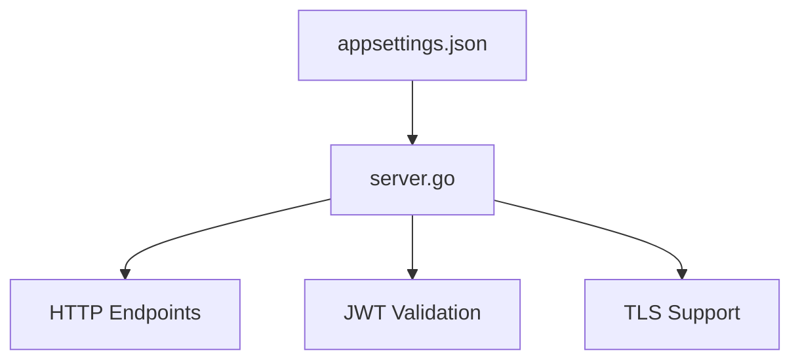

# serbathome-oauth-mock-server

A mock OAuth server for simulating authentication and authorization flows in development and testing environments.

## Overview

This project provides a lightweight mock OAuth server that simulates authentication endpoints and JWT validation. It is designed to help developers test integrations with OAuth-protected APIs without requiring access to a real identity provider.

The server reads configuration from a JSON file, exposes configurable endpoints, and supports both HTTP and optional TLS.

## Features

- Configurable OAuth endpoints for simulating authentication flows
- JWT validation using a configurable JWKS URL
- Customizable issuer, audience, and endpoints via configuration
- Supports HTTP and optional TLS
- Basic authentication support
- Lightweight and easy to run locally or in Docker

## Architecture

The main components are:
- **server.go**: Main application entry point, HTTP server, and handler logic
- **appsettings.json**: Configuration file for endpoints, issuer, audience, and other settings
- **Dockerfile**: Containerization support for easy deployment



## Technology Stack

- Go (Golang)
- [github.com/golang-jwt/jwt/v4](https://github.com/golang-jwt/jwt)
- [github.com/MicahParks/keyfunc](https://github.com/MicahParks/keyfunc)
- Docker (optional)

## Prerequisites

- Go 1.22 or later
- (Optional) Docker
- (Optional) OpenSSL (for generating TLS certificates)

## Installation

```bash
git clone <repository-url>
cd serbathome-oauth-mock-server
# To build with Go
go build -o mock-server server.go
# Or use Docker
# docker build -t mock-server .
```

## Configuration

Edit `appsettings.json` to set:
- `issuer`: The expected issuer for JWTs
- `audience`: The expected audience for JWTs
- `jwksUrl`: JWKS endpoint for public keys
- `authHeaderName`: Header name for JWT
- `basicAuthUsername` / `basicAuthPassword`: Basic auth credentials
- `port`: Port to run the server (e.g., ":8080")
- `endpoints`: List of endpoint paths to expose
- `enableTLS`: Set to `true` to enable TLS

Example:
```json
{
    "issuer": "https://sts.windows.net/your-tenant-id/",
    "audience": "api://your-api-id",
    "jwksUrl": "https://login.microsoftonline.com/common/discovery/keys",
    "authHeaderName": "x-ews-jwt-auth",
    "basicAuthUsername": "username",
    "basicAuthPassword": "password",
    "port": ":8080",
    "endpoints": ["/delta_extension1", "/delta_extension2"],
    "enableTLS": false
}
```

If TLS is enabled, generate certificates:
```bash
openssl req -x509 -newkey rsa:2048 -keyout server.key -out server.crt -days 365 -nodes -subj "/CN=localhost"
```

## Usage

To run locally:
```bash
go run server.go
```
Or run the built binary:
```bash
./mock-server
```
Or with Docker:
```bash
docker run -p 8080:8080 mock-server
```

## Development

- Build: `go build -o mock-server server.go`
- Run: `go run server.go`
- Docker build: `docker build -t mock-server .`
- TODO: Add test and lint instructions

## Project Structure

```
server.go         # Main application logic
appsettings.json  # Configuration file
Dockerfile        # Docker support
README.MD         # Project documentation
go.mod, go.sum    # Go module dependencies
```

## Troubleshooting

- Ensure Go 1.22+ is installed
- Check `appsettings.json` for correct configuration
- For TLS, ensure `server.crt` and `server.key` exist if `enableTLS` is true
- Use `go mod tidy` if dependencies are missing
- TODO: Add more troubleshooting tips

## Contributing

- Fork the repository and create a feature branch
- Follow standard pull request workflow
- Ensure code is well-documented and tested
- TODO: Add code review and branching details

## License

TODO: Add license information

